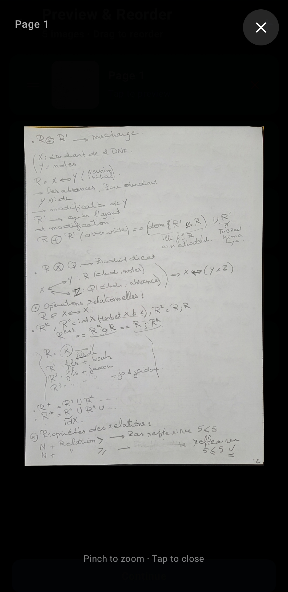
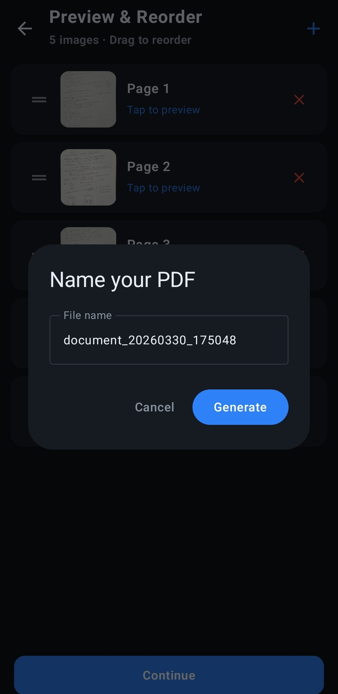
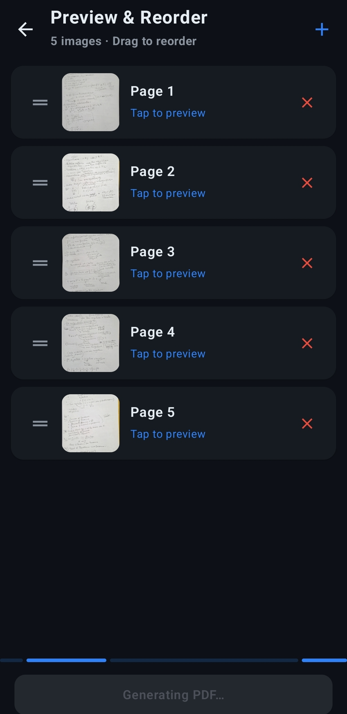
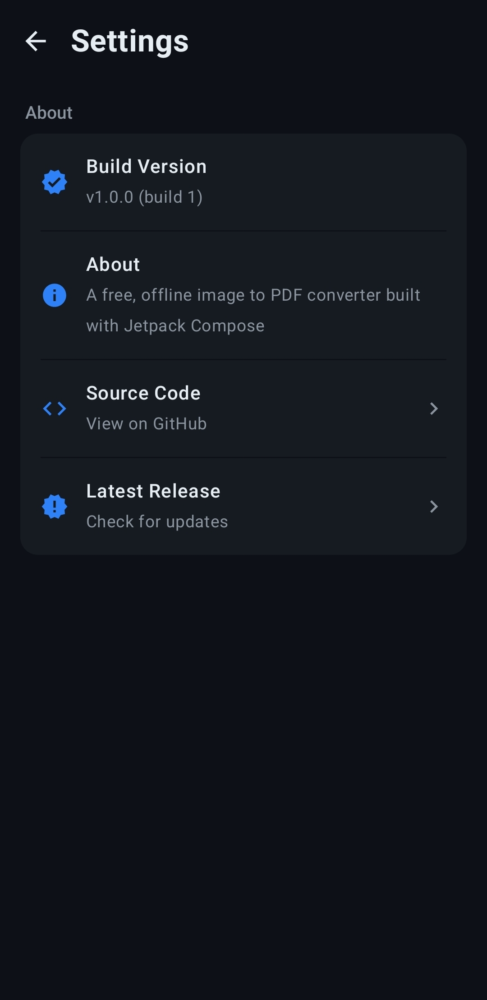

# 📄 Image to PDF Converter (Jetpack Compose)

A sleek, offline **PDF toolkit & image-to-PDF converter** built entirely with Kotlin and Jetpack Compose. Featuring a polished **dark-themed UI with blue accents**, the app lets you convert images, scan documents with CameraX, compress, merge, split, and export PDFs, and convert DOCX or plain text — all saved locally on your device.

---

## ✨ Features

- **🖼️ Image to PDF & Reorder:** Pick multiple images, preview full-screen with pinch-to-zoom, drag to reorder pages, select `A4`, `Letter`, or `Fit Image` page sizes, and save with custom naming and overwrite/increment conflict handling.
- **📷 Smart Scan (CameraX):** Capture document pages with flash/lens toggles, A4 alignment overlay, gallery fallback, and local image filters (`Original`, `Magic Contrast`, `Crisp B&W`) with EXIF rotation correction.
- **📥 Import PDF:** Bring existing PDF files into your workspace via the document picker and view them immediately in Recent PDFs.
- **🗜️ Compress PDF:** Shrink PDF file sizes locally across three quality presets (`Low`, `Balanced`, `Extreme`) with byte-savings reporting.
- **🧩 Merge PDF:** Combine multiple PDFs in custom drag-and-drop order.
- **✂️ Split & Extract PDF:** Select page thumbnails or enter page range expressions (e.g., `1-3, 5`) to extract or split pages into individual or single PDFs.
- **🖼️ PDF to JPG:** Export selected or all PDF pages to `Pictures/ImageToPdf` in `Standard` or `HD` resolution and share directly.
- **📝 DOCX to PDF & Text to PDF:** Convert Word `.docx` files (headings, paragraphs, lists, tables, embedded images) and plain text notes into paginated A4/Letter PDFs completely offline.
- **⭐ Favorites, Search & Sort:** Star favorite PDFs (persisted with DataStore Preferences), search in real time, and sort by date, name, or size.
- **📤 Share, Rename & Delete:** Open, share, rename, or remove documents safely via `FileProvider` and `MediaStore`.
- **⚙️ Settings & Info:** View build info, app details, and source links.
- **🚀 Offline-First:** Zero internet requirement (`usesCleartextTraffic="false"`) — all document processing runs locally on your device.

---

## 🚀 Tech Stack

- **Language:** [Kotlin](https://kotlinlang.org/)
- **UI Framework:** [Jetpack Compose](https://developer.android.com/jetpack/compose) + [Material 3](https://m3.material.io/)
- **Camera & Enhancement:** [CameraX](https://developer.android.com/training/camerax) + [AndroidX ExifInterface](https://developer.android.com/jetpack/androidx/releases/exifinterface)
- **PDF Generation & Rendering:** [PdfDocument](https://developer.android.com/reference/android/graphics/pdf/PdfDocument) & [PdfRenderer](https://developer.android.com/reference/android/graphics/pdf/PdfRenderer)
- **DOCX Parsing:** [XmlPullParser](https://developer.android.com/reference/org/xmlpull/v1/XmlPullParser) + `ZipInputStream` + `StaticLayout` (offline, zero heavy JVM dependencies)
- **Persistence & Media:** [DataStore Preferences](https://developer.android.com/topic/libraries/architecture/datastore), [MediaStore](https://developer.android.com/reference/android/provider/MediaStore) (Android 10+), `FileProvider`
- **Image Loading & Drag-and-Drop:** [Coil](https://coil-kt.github.io/coil/) & [Reorderable](https://github.com/Calvin-LL/Reorderable)
- **Architecture & Navigation:** MVVM (`StateFlow` + `ViewModel`) & [Navigation Compose](https://developer.android.com/jetpack/compose/navigation)
- **Min SDK:** 26 · **Target SDK:** 35

---

## 🎨 Design System

| Token              | Value       |
|--------------------|-------------|
| Background         | `#0D1117`   |
| Card / Surface     | `#161B22`   |
| Primary Text       | `#E6EDF3`   |
| Secondary Text     | `#8B949E`   |
| Accent (Blue)      | `#2F81F7`   |
| PDF Badge (Red)    | `#E74C3C`   |
| Corner Radius      | 12 – 16 dp  |

Dark-only theme with clean sans-serif typography.

---

## 🗂️ Project Structure

```
tech.youssefachraf.image_to_pdf/
├── MainActivity.kt
├── data/
│   └── FavoritesRepository.kt
├── navigation/
│   └── AppNavGraph.kt
├── ui/
│   ├── common/
│   │   ├── PdfIntentActions.kt
│   │   └── ToolUiComponents.kt
│   ├── splash/SplashScreen.kt
│   ├── home/
│   │   ├── HomeScreen.kt
│   │   └── components/
│   │       ├── MoreToolsSheet.kt
│   │       ├── PdfCard.kt
│   │       └── ToolGrid.kt
│   ├── files/FilesScreen.kt
│   ├── search/SearchScreen.kt
│   ├── settings/SettingsScreen.kt
│   ├── scan/SmartScanScreen.kt
│   ├── picker/
│   │   ├── ImagePickerSheet.kt
│   │   └── PreviewReorderScreen.kt
│   ├── tools/
│   │   ├── CompressPdfScreen.kt
│   │   ├── DocxToPdfScreen.kt
│   │   ├── MergePdfScreen.kt
│   │   ├── PdfToJpgScreen.kt
│   │   ├── SplitPdfScreen.kt
│   │   └── TextToPdfScreen.kt
│   └── theme/
│       ├── Color.kt
│       ├── Theme.kt
│       └── Type.kt
├── viewmodel/
│   ├── MainViewModel.kt
│   ├── PickerViewModel.kt
│   └── ToolsViewModel.kt
└── utils/
    ├── DocumentEnhancer.kt
    ├── DocxToPdfConverter.kt
    ├── PdfConverter.kt
    ├── PdfPageCanvasWriter.kt
    ├── PdfThumbnailCache.kt
    └── PdfToolkit.kt
```

---

## 📸 Screenshots

### 🏠 Home & File Management
Browse your tools and recently created PDFs, search, share, rename, or delete.

<p align="center">
  
  
  
</p>

### 🖼️ Image Selection, Reorder & Generation
Pick images, preview them full-screen, drag to reorder pages, and generate your PDF.

<p align="center">
  
  
  
</p>
<p align="center">
  
  
</p>

### ⚙️ Settings
View app info and access the source code.

<p align="center">
  
</p>

---

## 🛠️ Build & Run

```bash
# Clone
git clone https://github.com/ACHRAF-YOUSSEF/kotlin-projects.git
cd kotlin-projects/image-to-pdf

# Build debug APK
./gradlew assembleDebug

# Install on connected device
./gradlew installDebug
```

---

## 📄 License

This project is open-source and available under the [MIT License](LICENSE).

